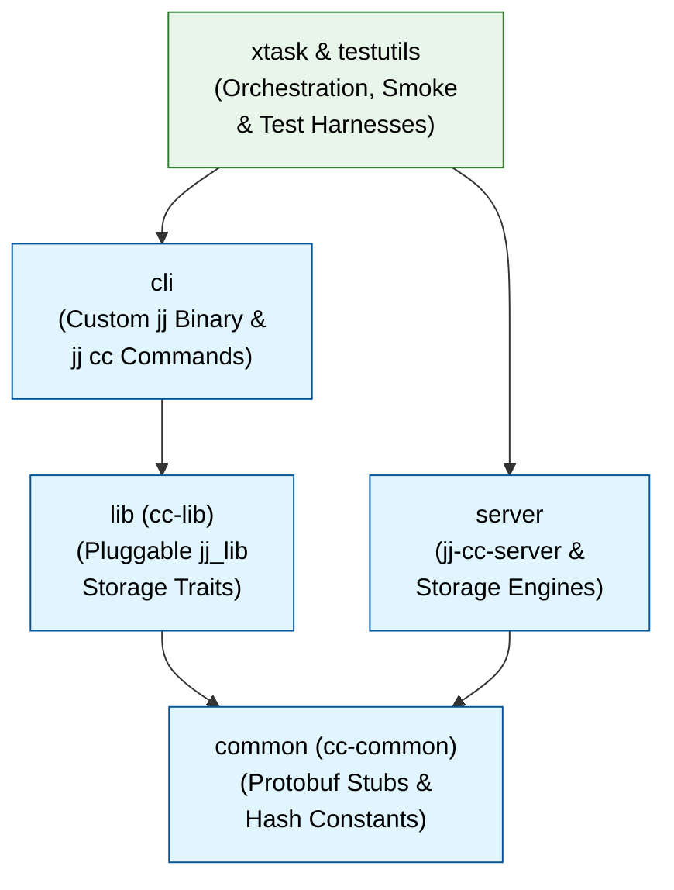
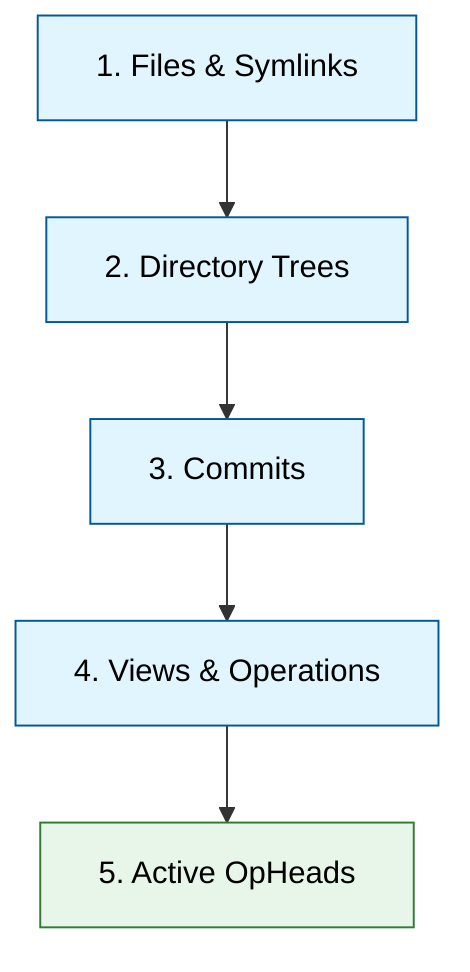
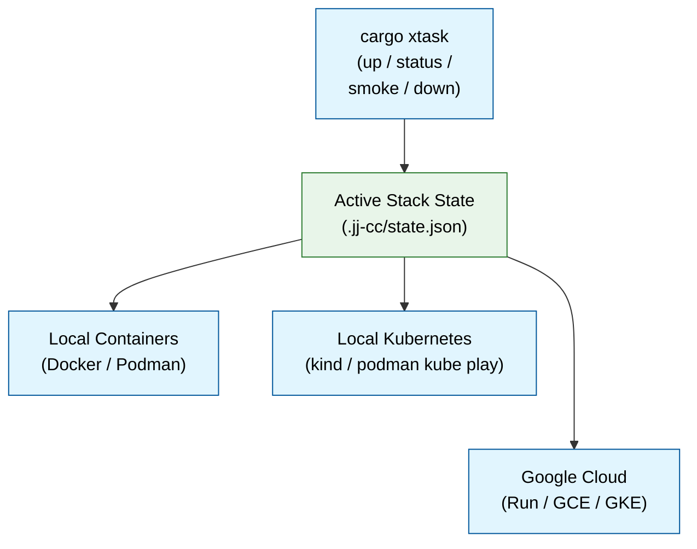
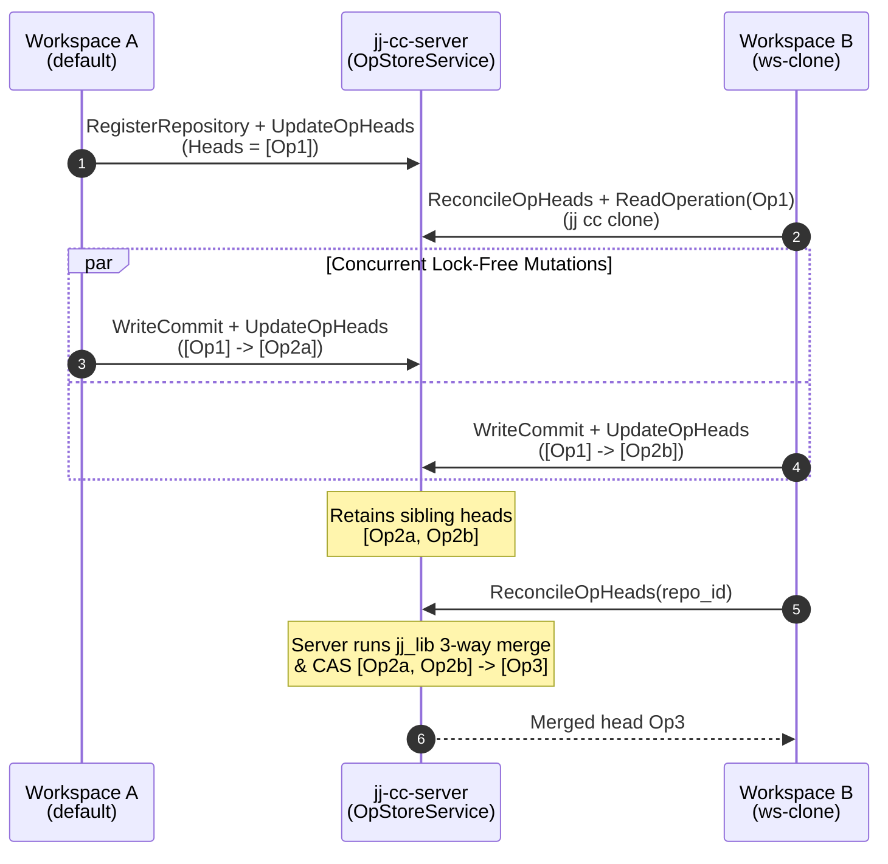
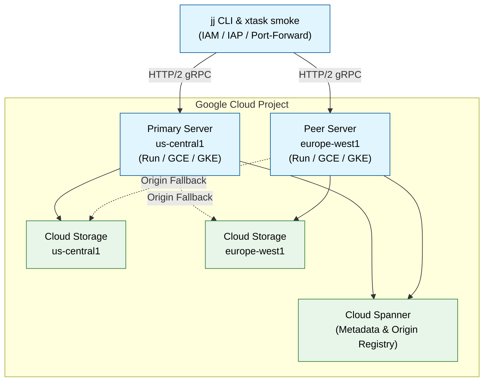

# Developer and Deployment Guide

## Summary

jj-commit-cloud builds as a self-contained Rust Cargo workspace producing jj-cc-server (the remote gRPC storage service), a custom [jj](https://github.com/jj-vcs/jj) CLI binary with `jj cc` cloud subcommands, jj-cc-daemon (an optional per-user local two-tier caching proxy), and a cross-platform `cargo xtask` workflow driver. Contributors can build and test everything natively with `cargo`, run containerized stacks via [compose.yaml](../compose.yaml) or local Kubernetes manifests under [deploy/k8s/](../deploy/k8s/), or deploy multi-region stacks to Google Cloud, and verify end-to-end version checkouts with `cargo xtask smoke`.

For the conceptual architecture and domain schemas, read [System Design](design.md) and [Data Model](data-model.md) first.

## Workspace Crate Layout

<!--
Diagram styling and update instructions:
- Uses Mermaid flowchart TD with quoted node labels, <br/> line breaks that keep the diagram within the page width, and standard palette classes (#e1f5fe fill, #01579b border for active components; #e8f5e9 fill, #2e7d32 border for storage backends).
- To update: edit the node or edge declarations below and run `jj fix -s @`.
-->


Workspace members declared in [Cargo.toml](../Cargo.toml):

* **Protocol Definitions ([common](../common/)):** Compiles [common/proto/backend.proto](../common/proto/backend.proto), [common/proto/op_store.proto](../common/proto/op_store.proto), and [common/proto/workspace.proto](../common/proto/workspace.proto) into `tonic` client and server stubs and exports digest-length and virtual-root constants.
* **Client Storage Adapters ([lib](../lib/)):** Implements `jj_lib`'s `Backend`, `OpStore`, `OpHeadsStore`, `IndexStore`, and `WorkingCopy` traits, plus Git import/export, over gRPC.
* **Commit Cloud Server ([server](../server/)):** Hosts jj-cc-server, canonical object hashing, server-side operation-head reconciliation, and pluggable storage adapters.
* **Local Caching Proxy Daemon ([daemon](../daemon/)):** Builds jj-cc-daemon, caching immutable `Commit`, `Tree`, `Symlink`, `File`, `View`, and `Operation` reads across an L1 memory LRU and an L2 local disk cache with per-`(server, repo_id)` scope isolation.
* **Custom CLI Binary ([cli](../cli/)):** Embeds `jj_cli` registered with the Commit Cloud backend factories and the `jj cc` command family.
* **Test Harness ([testutils](../testutils/)):** Compiles server binaries during `cargo test` and manages ephemeral test servers and emulators.
* **Workflow Driver ([xtask](../xtask/)):** Implements `cargo xtask build`, `up`, `status`, `smoke`, `bench`, and `down` in Rust across Linux, macOS, and Windows without requiring `make` or Bash scripts.

## Building and Running Tests

[rust-toolchain.toml](../rust-toolchain.toml) selects the `stable` Rust channel (`1.96.0+` for Rust 2024 edition), [.cargo/config.toml](../.cargo/config.toml) registers the `cargo xtask` alias and Windows stack-size flags, [common/build.rs](../common/build.rs) falls back to a vendored `protoc` binary when `protoc` is not installed on the host, and the multi-target [Dockerfile](../Dockerfile) builds reproducible server and test images.

```bash
# Native workspace build and full automated test suite:
cargo build --workspace
cargo test --workspace

# Containerized build via Docker or Podman:
cargo xtask build --container --export-bin
```

### Protobuf Service Contracts

Editing [common/proto/backend.proto](../common/proto/backend.proto), [common/proto/op_store.proto](../common/proto/op_store.proto), and [common/proto/workspace.proto](../common/proto/workspace.proto) triggers automatic stub regeneration in [common/src/lib.rs](../common/src/lib.rs) during `cargo build`. All mutations follow bottom-up referential order so readers never encounter dangling object IDs:

<!--
Diagram styling and update instructions:
- Uses Mermaid flowchart TD with quoted node labels, <br/> line breaks that keep the diagram within the page width, and standard palette classes (#e1f5fe fill, #01579b border for active components; #e8f5e9 fill, #2e7d32 border for storage backends).
- To update: edit the node or edge declarations below and run `jj fix -s @`.
-->


## Extending Storage Backends

Graph metadata and raw file byte streams have distinct consistency and scaling requirements. [server/src/store/mod.rs](../server/src/store/mod.rs) isolates them behind two async traits coordinated by `CompositeStore`:

* **Metadata Backend (`MetadataStore`):** Persists repository registration, commits, directory trees, symlinks, views, operations, serializable `update_op_heads` transitions, and `(project_id, blob_id)` reachability records.
* **Blob Backend (`BlobStore`):** Writes and reads content-addressed file bytes (`put_blob`, `get_blob`, and byte-ranged `get_blob_range_with_record`), deduplicating identical file payloads while preserving read isolation.
* **Write-Before-Publish Coordination (`CompositeStore`):** Uploads file bytes to `BlobStore` before publishing metadata records and verifies child blobs, symlinks, subtrees, parent commits, views, and operations before accepting parent writes, mapping typed `StoreError` variants to gRPC status codes.

## Launching Topologies With `cargo xtask` and Compose

`cargo xtask up <mode>` records the active topology and endpoint URLs in `.jj-cc/state.json` so `cargo xtask status`, `cargo xtask smoke`, and `cargo xtask down` know which stack is running without extra flags:

<!--
Diagram styling and update instructions:
- Uses Mermaid flowchart TD with quoted node labels, <br/> line breaks that keep the diagram within the page width, and standard palette classes (#e1f5fe fill, #01579b border for active components; #e8f5e9 fill, #2e7d32 border for storage backends).
- To update: edit the node or edge declarations below and run `jj fix -s @`.
-->


| Mode | Backing Storage | Runtime | Launch Command |
| :--- | :--- | :--- | :--- |
| `memory` | In-memory metadata and blobs | Docker / Podman (or `--driver=native`) | `cargo xtask up memory` |
| `sqlite` | SQLite `WAL` + local disk blob store | Docker / Podman (or `--driver=native`) | `cargo xtask up sqlite` |
| `spanner` | Cloud Spanner Emulator + local/emulated blobs | Docker / Podman containers | `cargo xtask up spanner` |
| `multiregion` | Shared Spanner Emulator + two regional Cloud Storage buckets (`:8081` US, `:8082` EU) | Docker / Podman containers | `cargo xtask up multiregion` |
| `k8s` | Containerized Commit Cloud Pod | `kind` + `kubectl` or `podman kube play` | `cargo xtask up k8s` |
| `k8s-multiregion` | Two-region server Pod (`:8081` US, `:8082` EU) | `kind` + `kubectl` or `podman kube play` | `cargo xtask up k8s-multiregion` |
| `cloud-run` | Managed Cloud Spanner + Cloud Storage | Serverless Cloud Run (HTTP/2 + IAM) | `cargo xtask up cloud-run --project <ID>` |
| `gce` | Managed Cloud Spanner + Cloud Storage | Compute Engine VM + IAP TCP tunnel | `cargo xtask up gce --project <ID>` |
| `gke` | Managed Cloud Spanner + Cloud Storage | GKE Autopilot + Workload Identity + port-forward | `cargo xtask up gke --project <ID>` |

On machines without a local Rust toolchain (or when running container engines directly without `cargo xtask`), the [Dockerfile](../Dockerfile), [compose.yaml](../compose.yaml), and [deploy/k8s/](../deploy/k8s/) manifests run directly with `docker` or `podman`:

```bash
# Standalone Docker or Podman containers (no Compose plugin required):
CONTAINER=docker   # or: CONTAINER=podman
$CONTAINER build --target server -t jj-cc-server:local .
$CONTAINER build --target cli -t jj-cc-cli:local .
$CONTAINER network create jj-cc-net
$CONTAINER run -d --name jj-cc-server --network jj-cc-net -p 127.0.0.1:8080:8080 \
  -e STORE_TYPE=sqlite -e BLOB_STORE=local -e SQLITE_PATH=/data/commit_cloud.db -e BLOB_PATH=/data/blobs jj-cc-server:local
$CONTAINER run --rm --network jj-cc-net --entrypoint xtask jj-cc-cli:local \
  smoke --jj-bin /usr/local/bin/jj --server http://jj-cc-server:8080
$CONTAINER rm -f jj-cc-server && $CONTAINER network rm jj-cc-net

# Docker Compose (requires the `docker compose` plugin):
docker compose --profile spanner up -d --build
docker compose --profile smoke run --rm smoke
docker compose down -v

# Local Kubernetes via Podman (`podman kube play`) or `cargo xtask`:
podman kube play deploy/k8s/sqlite.yaml
podman kube down deploy/k8s/sqlite.yaml
```

<!--
Diagram styling and update instructions:
- Uses Mermaid sequenceDiagram with <br/> line breaks in participant labels and messages to keep horizontal width compact; the init directive narrows participant boxes and margins so every participant fits the page width.
- To update: edit the sequence steps below and run `jj fix -s @`.
-->


## End-to-End Client Walkthrough

```bash
# Start a local Commit Cloud stack:
cargo xtask up sqlite

# Create a cloud repository and author two revisions in Workspace 1:
cargo run -p cli -- cc init --server http://127.0.0.1:8080 --create /tmp/ws1
printf 'pub const VERSION: &str = "v1";\n' > /tmp/ws1/lib.rs
cargo run -p cli -- -R /tmp/ws1 describe -m "release v1"
V1=$(cargo run -p cli -- -R /tmp/ws1 log --no-graph -r @ -T commit_id)

cargo run -p cli -- -R /tmp/ws1 new
printf 'pub const VERSION: &str = "v2";\n' > /tmp/ws1/lib.rs
cargo run -p cli -- -R /tmp/ws1 describe -m "release v2"
REPO_ID=$(sed -n 's/^repo_id = "\(.*\)"/\1/p' /tmp/ws1/.jj/repo/store/config.toml)

# Clone into Workspace 2 and check out historical revision v1:
cargo run -p cli -- cc clone --server http://127.0.0.1:8080 "$REPO_ID" /tmp/ws2
cargo run -p cli -- -R /tmp/ws2 new "$V1"
# Export Commit Cloud commits and bookmarks to a standard Git repo (or import an existing Git repo):
cargo run -p cli -- -R /tmp/ws1 bookmark set main -r @
cargo run -p cli -- -R /tmp/ws1 cc export-git --bare --git-dir /tmp/exported.git
cargo run -p cli -- cc import-git --server http://127.0.0.1:8080 --create --git-dir /tmp/exported.git

# Enable the local caching proxy and run a 16-agent concurrent benchmark:
cargo run -p cli -- cc daemon enable
cargo run -p cli -- cc daemon status
cargo xtask bench --agents 16 --commits-per-agent 4 --daemon

cargo xtask down --purge
```

## Deploying to Google Cloud and Spanner Omni

jj-cc-server supports three Google Cloud compute targets sharing a common Cloud Spanner ([server/sql/spanner_schema.sql](../server/sql/spanner_schema.sql)) and Cloud Storage persistence tier:

<!--
Diagram styling and update instructions:
- Uses Mermaid flowchart TD with quoted node labels, <br/> line breaks that keep the diagram within the page width, and standard palette classes (#e1f5fe fill, #01579b border for active components; #e8f5e9 fill, #2e7d32 border for storage backends).
- To update: edit the node or edge declarations below and run `jj fix -s @`.
-->


Given an authenticated `gcloud` CLI and project ID, `cargo xtask up` provisions the Cloud Spanner database, Cloud Storage bucket(s), service-account bindings, container image, and chosen compute target:

```bash
export PROJECT_ID="your-gcp-project-id"

# Option 1 - Serverless Cloud Run (HTTP/2 + IAM auth, optional --peer-region):
cargo xtask up cloud-run --project "$PROJECT_ID" --region us-central1 --peer-region europe-west1
cargo xtask smoke

# Option 2 - Dedicated Compute Engine VM over a private IAP TCP tunnel
# (or pass --gce-public-ip --allow-cidr <CIDR> to restrict ingress and enable bearer auth):
cargo xtask up gce --project "$PROJECT_ID" --region us-central1
cargo xtask smoke

# Option 3 - GKE Autopilot cluster with Workload Identity and ClusterIP port-forward:
cargo xtask up gke --project "$PROJECT_ID" --region us-central1
cargo xtask smoke

# Tear down compute while keeping storage (pass --purge to delete storage created by up):
cargo xtask down
```

Cloud Run enforces IAM identity tokens, Compute Engine defaults to an Identity-Aware Proxy TCP tunnel, and GKE exposes a private ClusterIP service reached over a managed `kubectl port-forward`; passing `--gce-public-ip` requires `--allow-cidr` and configures a generated `JJ_CC_SERVER_AUTH_TOKEN` recorded in `.jj-cc/state.json`. Separate `--env <name>` slots isolate Cloud Storage bucket, Cloud Spanner database, Cloud Run service, and GKE cluster names, and `cargo xtask down --purge` deletes storage resources created by that environment while leaving pre-existing resources intact.

For self-hosted Kubernetes or on-premises [Spanner Omni](https://cloud.google.com/products/spanner/omni) deployments, pass `--spanner-omni` along with the endpoint URL, TLS/mTLS certificates, and an explicit blob store such as `--blob-path` on persistent storage or `--gcs-bucket`:

```bash
jj-cc-server \
  --host=0.0.0.0 \
  --port=8080 \
  --store-type=spanner \
  --spanner-omni \
  --spanner-endpoint=https://spanner-omni.internal:9010 \
  --spanner-database=projects/omni/instances/default/databases/commit-cloud \
  --spanner-omni-ca-cert=/etc/jj-cc/ca.pem \
  --spanner-omni-client-cert=/etc/jj-cc/client.pem \
  --spanner-omni-client-key=/etc/jj-cc/client.key \
  --blob-store=local \
  --blob-path=/var/lib/jj-cc/blobs
```

When `--auth-token` (or `JJ_CC_SERVER_AUTH_TOKEN`, supporting comma-separated token rotation) is configured on jj-cc-server, clients authenticate by setting `JJ_CC_AUTH_TOKEN`, while gRPC health probes remain open for container orchestrators.
